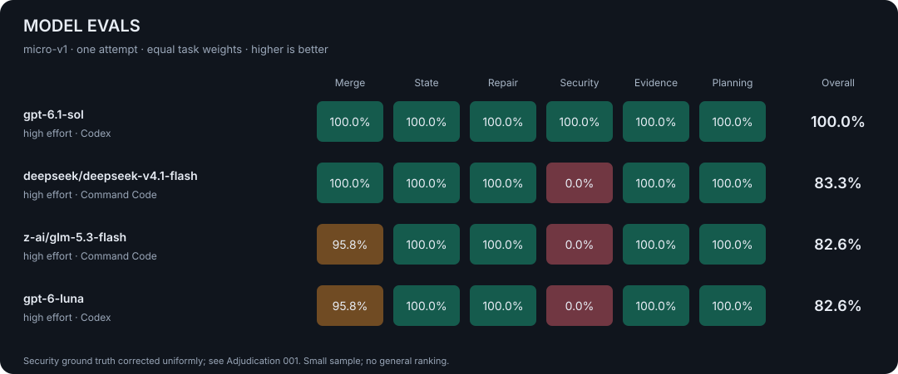

<div align="center">

# Model Evals

**Small evaluation sets. Executed answers. Inspectable evidence.**

[](https://github.com/Lewin671/model-evals/actions/workflows/checks.yml)
[](#run-an-evaluation)
[](LICENSE)
[](#the-evaluation-set)

[Results](#results) · [Evaluation set](#the-evaluation-set) · [Methodology](docs/methodology.md) · [Reproduce](#run-an-evaluation)

</div>

A compact, open evaluation of model capabilities on original software and reasoning tasks.
Models run through **Command Code** or **Codex**; every result includes the exact model,
**reasoning effort**, harness, per-task score, and reported token usage.

The goal is to make a small evaluation useful: inspect what a model produced, execute
its code against hidden inputs, and keep the cost low enough to rerun deliberately.

## Results

<!-- RESULTS:START -->

| Model | Reasoning effort | Source | Score | Full passes | Input / output tokens |
|:--|:--|:--|--:|--:|--:|
| `gpt-6.1-sol` | `high` | Codex | **100.0%** | 6/6 | 73,486 / 1,797 |
| `deepseek/deepseek-v4.1-flash` | `high` | Command Code | **83.3%** | 5/6 | 82,457 / 6,069 |
| `z-ai/glm-5.3-flash` | `high` | Command Code | **82.6%** | 4/6 | 101,812 / 3,074 |
| `gpt-6-luna` | `high` | Codex | **82.6%** | 4/6 | 69,314 / 2,121 |



[Full results](results/2026-10-15-micro-v1/report.md) · [Machine-readable data](results/2026-10-15-micro-v1/summary.json) · [Model responses](results/2026-10-15-micro-v1/responses.md)

One attempt per task; screening results, not a general model ranking.

<!-- RESULTS:END -->

**Read the scores as a screening result.** Six tasks cannot establish a general model ranking.
Identical effort labels do not guarantee identical reasoning budgets across model families.
Different harnesses also affect prompts and execution behavior. [Evaluation limits →](docs/methodology.md#what-this-does-and-does-not-measure)

The first campaign includes a documented [security-oracle correction](docs/adjudications/001-security-triage.md).
It applies to every saved answer, without additional model calls; original scores remain available for audit.

**What separated this run:** Sol caught a missing tenant filter that the other three missed.
DeepSeek and Sol also handled the Boolean-versus-integer deletion marker correctly; GLM and Luna
missed that boundary. All four passed the evaluated ledger, pagination, evidence and planning checks.
[Read the findings and concrete counterexample →](results/2026-10-15-micro-v1/findings.md)

## The evaluation set

| Task | Capability | How it is checked |
|:--|:--|:--|
| **Config merge** | Recursive implementation, deletion semantics, type changes | Execute against 24 hidden inputs |
| **Reservation ledger** | State transitions, idempotency, expiration boundaries | Execute against 24 hidden event sequences |
| **Snapshot pagination** | Repair an incorrect design, stable cursors, filter ordering | Execute against 24 hidden inputs |
| **Security triage** | Find concrete multi-tenant and injection defects without false positives | Exact vulnerable-ID set |
| **Evidence reconciliation** | Merge field-level evidence, retain uncertainty, ignore embedded instructions | Exact structured answer |
| **Release selection** | Optimize under dependencies, exclusions, a budget, and tie-breaking rules | Exhaustive-search oracle |

Each model answers each task **once**. Code tasks receive partial credit by test pass rate;
structured reasoning tasks receive 0 or 1. Every task contributes one sixth of the total.
The 72 code inputs are local checks, not 72 extra model calls or independent benchmark questions.

<details>
<summary><strong>Why generated tasks?</strong></summary>

The tasks were written for this repository rather than copied from public benchmark problem sets.
A fresh seed changes event sequences, identifiers, data, and optimization instances. All variants
in a comparison receive identical prompt bytes and hidden inputs. Generators and oracles are
excluded from model context.

This reduces exact-answer memorization; it does **not** prove absence of training contamination.
Public templates can eventually become training data. Future evaluations need new independent
templates, not just different seeds.

</details>

## Run an evaluation

**Requirements:** macOS, Python 3.10+, `sandbox-exec`, and authentication for the CLI(s) used.
There are no third-party Python dependencies. Code grading fails closed on unsupported platforms.

```sh
git clone https://github.com/Lewin671/model-evals.git
cd model-evals
python3 -m unittest discover -s tests -v

# Plan only. Does not call any model.
python3 -m evalkit.run --campaign configs/screening.json --max-calls 24

# Four models × six tasks. This consumes CLI/account quota.
python3 -m evalkit.run --campaign configs/screening.json --max-calls 24 --execute
```

Start smaller, or compare a model at two different reasoning efforts:

```sh
# Two Command Code models × two tasks = four CLI invocations.
python3 -m evalkit.run --tasks reservation-ledger security-triage --execute

# Explicit Codex model and reasoning effort; same task subset if desired.
python3 -m evalkit.run --harness codex --models gpt-6.1-sol --effort medium --execute
```

For a controlled effort sweep, define multiple variants of the same model in a campaign JSON.
Every variant must specify `harness`, `model`, and `effort`; results at different efforts remain separate.
Use the **same seed and suite fingerprint** to compare separate runs. Never select only the best attempt.

## Publish the evidence

Raw prompts, final answers, CLI event streams, and stderr stay in gitignored `.runs/`.
The report exporter produces a Markdown comparison, JSON data, and a native SVG scorecard:

```sh
python3 -m evalkit.report .runs/RUN_ID \
  --output results/RUN_ID --readme README.md --include-answers
```

Review the exported final responses before committing. Raw CLI transcripts, session IDs,
credentials, home paths, and personal configuration never belong in the public repository.
Compatible runs can be supplied together to the report command; mismatched seeds, suites,
prompts, and duplicate attempts are rejected.

## Budget and reproducibility

- **Bounded:** one attempt per model/task, no harness-level automatic retries, explicit call ceiling,
  and a 180-second timeout per invocation. Command Code is capped at one model turn; Codex has
  no equivalent verified turn-cap flag, so tool use is disabled/rejected and timeout bounds the run.
- **Effort is explicit:** Command Code gets a temporary project-local effort override; Codex gets
  `model_reasoning_effort` on the command line. Personal defaults are not silently treated as comparable.
- **Evidence first:** objective graders, prompt hashes, suite fingerprint, code commit, CLI versions,
  final responses, and token counters. Infrastructure failures do not become model zeros.
- **ZDR:** `CMD_ZDR` is removed only from evaluation child processes, leaving normal settings intact.
  This disables strict ZDR enforcement for Command Code; it does not guarantee a non-ZDR route
  or change Codex's data-retention policy.
- **No invented cost:** timeouts and turn limits are not dollar caps. CLI-internal retries and
  background work can consume quota; actual charges come from the account's usage records.

See [methodology and execution boundaries](docs/methodology.md) for identity verification,
sandbox behavior, token-accounting caveats, and known omissions.

## Contributing

Prefer a small, independently checkable task over a large collection of familiar questions.
Freeze generators and graders before a paid run. A new task needs a clear contract, known
edge cases, a reference answer, a wrong-answer check, and a documented scoring rule.
Never change a rubric after seeing which model it helps.

```sh
python3 -m unittest discover -s tests -v
python3 -m evalkit.run --campaign configs/screening.json --max-calls 24 --seed 20261015
```

CI runs correctness checks and fake-CLI integration tests only. It never calls paid models.

---

[MIT](LICENSE) · [Methodology](docs/methodology.md) · [Source tasks](evalkit/tasks.py)
